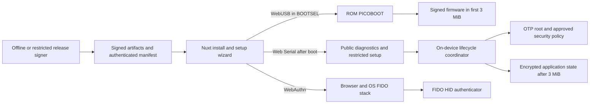

# Browser flashing, secure boot and device setup

Research date: 2026-11-15. This is a design and implementation plan, not an
implemented installer or a fuse-programming procedure. The current Nuxt app
only exercises application CDC ACM. Track release gates in the
[alpha roadmap](alpha-roadmap.md).

## Feasibility and recommended approach

**Browser firmware flashing is feasible:** use WebUSB to speak ROM PICOBOOT
while the RP2350 is in BOOTSEL, then reconnect with Web Serial after application
boot. Transporting an approved signed image does not require the browser to
possess its signing key.

**Browser-assisted secure-boot provisioning is feasible in principle**, using
a dedicated on-device provisioning workflow. It still needs implementation and
hardware qualification. Flashing a signed image and permanently enabling the
chip's signature enforcement are different operations. Do not label a board
secured merely because installation used a signed artifact.

Proposed alpha architecture:

Use ROM BOOTSEL initially; a custom runtime PICOBOOT interface or bootloader is
not required for the first installer. Re-evaluate one only if a qualified update
or recovery requirement cannot be met by the selected ROM policy.

## What PicoFlash provides, and what it does not

Reviewed [piersfinlayson/picoflash](https://github.com/piersfinlayson/picoflash),
whose checked `pkg/package.json` reports `0.1.5`. The examined source is on
`main`; this research does not establish that a matching npm package or every
release URL contains those exact bytes. Pin a reviewed release/commit and record
its provenance before integration. A blob SHA is a file identity, not a release
or repository commit.

| Finding from the reviewed source | Consequence for this application |
| --- | --- |
| JavaScript WebUSB implementation for RP2040/RP2350 discovery and flash read/write/erase/reboot | Reuse a pinned copy behind a restricted update adapter |
| Methods accept addresses and buffers | Validate release format, board/capacity, all ranges and erase rounding before calling them |
| Flash operations are chunked and have transfer timeout handling | Useful transport behavior, still requires interruption/reconnect tests on our boards |
| `Connection.otpWrite()` immediately throws a disabled-operation error | Do not promise secure-boot activation through this helper or simply remove its guard |
| The website enables its OTP button after typed confirmation, but its actual `connection.otpWrite(...)` call is commented out; the handler still displays success | An enabled button or "OTP Write complete" banner is not evidence that OTP was written |
| API documentation and implementation differ in places | Review actual code and test the exact imported version; do not infer physical flash bounds from documented address-space constants |

Sources: [README](https://github.com/piersfinlayson/picoflash/blob/main/README.md),
[API](https://github.com/piersfinlayson/picoflash/blob/main/API.md),
[package version](https://github.com/piersfinlayson/picoflash/blob/main/pkg/package.json),
[connection implementation](https://github.com/piersfinlayson/picoflash/blob/main/pkg/connection.js),
[target implementation](https://github.com/piersfinlayson/picoflash/blob/main/pkg/target.js),
[changelog](https://github.com/piersfinlayson/picoflash/blob/main/CHANGELOG.md).

The UI discrepancy was also checked against the published `gh-pages` branch:
[website handler](https://github.com/piersfinlayson/picoflash/blob/gh-pages/js/flash/picoflash.js#L2202-L2218)
and [library guard](https://github.com/piersfinlayson/picoflash/blob/gh-pages/pkg/connection.js#L480-L481).
The confirmation string gates the button, not the disabled write path. This is
a source inspection, not a physical OTP-write test; browser/CDN caches may serve
different revisions. The PICOBOOT protocol has an OTP write command, so this
is an implementation restriction rather than a general WebUSB limitation.

PicoFlash is a transport dependency, not our release verifier, compatibility
policy, user-consent mechanism, signed-image builder or provisioning policy.
Ship a reviewed, pinned local/bundled version with its applicable license notice;
do not import the moving upstream `main` URL at runtime in a release installer.

The ordinary updater adapter should not expose raw OTP access, arbitrary memory
addresses, execute-at-address operations or arbitrary full-chip erase controls.
Its only write input is an approved artifact and the validated firmware-only
write plan. Do not copy the upstream generic flash/OTP console into the setup UI.

## Three separate trust domains

| Key/state | Generated and held where | Lifetime |
| --- | --- | --- |
| Firmware signing private key | Controlled release-signing environment; never shipped to browser/device | Project release trust, with a planned rotation/recovery policy |
| Firmware verification public-key hash | Derived using the reviewed signing workflow, stored in device OTP | Accepted boot signer(s); public information |
| Device root secret | Generated by the device's hardware-backed CSPRNG, stored/sealed in OTP | Device lifetime; preserved across firmware updates/reset |
| Mutable credential key | Generated on-device, authenticated/encrypted under the root in flash | Preserved on update; replaced by authenticator reset |
| FIDO PIN/token state | Managed by the authenticator and FIDO client path | Follows CTAP lifecycle; not a firmware signing or serial setup password |

The boot signer uses the RP2350 ROM's required signing format; current picotool
documents secp256k1 keys for `seal --sign`. This differs from CTAP ES256/P-256.
Use official tooling for the boot-key hash and signing representation rather
than inventing a public-key serialization. See
[picotool sealing](https://github.com/raspberrypi/picotool#seal).

The existing `provision_secure_boot_key_hash` method only writes the public hash
to BOOTKEY0 with readback verification. It deliberately does not mark the key
valid, enable secure boot, disable debug, configure boot paths, or finish the
device's security policy. See [the OTP guide](../firmware/src/otp/README.md).

## Signed artifact and update contract

Start with a single reviewed browser input format: a release-signed raw flash
image plus an authenticated manifest specifying its exact flash address and
length. Build/convert it using a pinned pipeline that preserves every required
ROM signature/metadata block. Qualify the resulting bytes on the ROM, not just
the ELF used to generate them. An ELF, UF2 container and raw flash image are
different formats; never write an entire UF2 file verbatim as raw flash bytes.

Publish a separate UF2/native recovery artifact if needed. If accepting UF2 in
the browser later, add a bounded parser validating block magic/lengths, family
and architecture, target addresses, block counts/completeness, ordering policy,
duplicates/overlaps, unsupported flags and final allowed write ranges. Until
that parser exists, reject the format explicitly.

The release manifest needs an authenticated encoding and verifier, not just
SHA-256 values downloaded beside the firmware. Its proposed contents are:

- Artifact/product identity, firmware prerelease version, artifact size/hash,
  image format and exact programming address/ranges.
- Supported board/silicon revisions, 4 MiB versus 16 MiB capacity, security
  profile and whether it is an isolated emulator/development artifact.
- Signing-key identity, the supported installed/data firmware versions,
  migration/downgrade policy, and minimum installer/setup-protocol compatibility.
- Required boot/recovery policy and an explicit declaration that the update
  does not request OTP writes or application-data erasure.

Bind the artifact hash and these constraints to the authenticated manifest.
Specify canonical signed bytes and how the installer trusts the manifest
verification key. Manifest signing may use a separate distribution key; it does
not replace the ROM image signature. Browser verification catches distribution
errors, while the enabled chip policy must reject unauthorized executable code.

Before *any* erase/write, the update planner must:

1. Verify the manifest and artifact bytes; reject unknown formats/profiles.
2. Establish board/capacity using qualified device information or an explicit
   supported-board selection where measurement is unavailable. The application's
   existing `flash_bytes` is a build constant, not independently measured flash
   capacity. A BOOTSEL chip ID/USB product ID alone does not establish it either.
3. Check compatibility with current persistent data and preserve unknown/newer
   versions instead of initializing them. With a broken application, require an
   appropriate compatible recovery artifact/known device profile; do not guess
   a destructive downgrade based on absence of INFO.
4. Produce a complete bounded plan in the API's correct address convention.
   Firmware offsets are `[0, 0x00300000)`; XIP addresses are
   `[0x10000000, 0x10300000)`. Storage begins at the exclusive firmware end.
5. Check arithmetic overflow, every segment/block, signed trailer, page padding,
   and rounded 4096-byte erase sectors against that boundary. A file-length
   check alone is insufficient for sparse/address-bearing inputs.
6. Refuse writes to storage, OTP or arbitrary RAM and refuse a full-chip erase.
   Recheck the selected device after every disconnect/re-enumeration.

Program with bounded transfers, verify the flashed image through the approved
readback/verification path, reboot, reconnect to the application and inspect its
reported version/state. A successful USB write does not establish successful boot
or signature enforcement. Only claim completion after the appropriate checks.
Where readback is prohibited by the security policy, define an alternative
verified result; do not silently skip verification and report success.

The browser is not a security boundary against a malicious page with raw ROM
access. Qualify ROM partition/access policy or a signed updater if enforcing data
write restrictions against hostile hosts is part of the threat model. Secure
boot authenticates executable images; it does not by itself make all flash
contents confidential or stop permitted destructive flash writes.

## Secure-boot provisioning workflow to implement

Treat this as a dedicated lifecycle operation. The eventual web app can guide
and request it, but an approved on-device provisioning implementation must own
the exact allowlisted fuse plan and state transitions. Do not accept arbitrary
OTP row/value maps, raw JSON fuse files or an arbitrary signing-key hash from a
web query parameter. The project's trust anchor belongs in the verified
provisioning policy; an owner-controlled trust mode would need a separate design.

1. **Identify and inspect.** Check supported silicon/board, current root-record
   state, boot key/validity/revocation state, boot/security/debug policy, required
   recovery interface and provisioning permissions. Recognize already completed
   and partially completed states without repeating writes.
2. **Prepare trusted images and recovery.** Build/verify the normal image and
   compatible recovery/provisioning helper under the intended signer. Establish
   an independently trusted installation source/public-key fingerprint for first
   use: a blank chip cannot authenticate our project before trust is installed.
3. **Present the immutable policy.** Explain which signer will control future
   updates, which debug/recovery paths will remain, and which actions are
   permanent. Obtain explicit confirmation and physical presence bound to that
   particular provisioning operation with an expiry.
4. **Execute a qualified sequence on-device.** Program/verify boot trust and
   activate enforcement according to the official procedure for that silicon;
   generate/seal the unique root and close required access paths in a controlled
   sequence. Determine the actual ordering from permission preconditions and
   recovery requirements, including the current OTP API's refusal to provision
   an already locked master page. Never assume a partially programmed page is
   safely reusable. Do not expose production roots during an intermediate
   debug/bootloader-accessible state.
5. **Verify across reboots.** Read back public policy through an approved path,
   boot the approved image, reject an unsigned/modified/wrong-key image, and
   recover with an approved signed image. Run destructive negative tests on
   sacrificial boards; the user wizard reports only checks actually performed.
6. **Finish application setup.** With trust established, initialize/validate
   defaults, the mutable credential key and authenticated completion state on
   the device. Repeated visits inspect existing state and offer only valid
   transitions; they do not generate another root.

This is not a literal row-programming order or executable runbook. Create that
silicon-specific, power-failure-aware runbook and qualify it before enabling
the browser button. Permission helpers may need to execute signed code after
secure boot is enabled. The official
[picotool OTP documentation](https://github.com/raspberrypi/picotool#otp) describes
OTP's irreversibility and its
[permission helper](https://github.com/raspberrypi/picotool#permissions).

Retain the ROM PICOBOOT path required by the installer, or replace it with a
qualified signed recovery/updater before disabling it. Prove root OTP is not
readable from that path. Review alternate boot modes and debugger access as part
of the same policy. A locked master page alone does not protect against arbitrary
trusted Secure firmware or an enabled Secure debugger. Follow the
[Raspberry Pi security guide](https://pip-assets.raspberrypi.com/categories/1260-security/documents/RP-009377-WP-1-Understanding%20RP2350_s%20security%20features.pdf).

Initial implementation should validate the sequence with native official tools
and sacrificial hardware. Then implement the narrow device-side operation and
web wizard, tested for equivalence. If this is not ready for a preview, retain
the native provisioning path and clearly mark browser security activation
unavailable. Downloading a signed image can still work on an already provisioned
board if its actual ROM/access policy permits the required flashing operations.

## First installation, application setup and later updates

The installer should guide these separate operations without exposing hardware
implementation detail in the ordinary happy path:

| Stage | Expected UI behavior |
| --- | --- |
| Select release | Pick supported board/capacity; display actual release version, compatibility and verified artifact status |
| Enter BOOTSEL | Explain native USB/button procedure; request WebUSB permission in a direct user action; reject unsupported devices |
| Flash | Display bounded programming/verification progress and actionable errors; no OTP mutation |
| Reconnect application | Release WebUSB; request the distinct Web Serial permission; assert DTR; send framed INFO |
| Provision security | Show existing security state or the explicit one-time approved provisioning flow; no fake success indicator |
| Initialize | Show startup reason, ask for physical confirmation and invoke only the permitted setup/resume operation |
| Enroll/test | Use WebAuthn/platform FIDO UI for test credentials and native/platform management where required |
| Update later | Preserve root and user state; verify release compatibility; program firmware only; validate/migrate and confirm boot |
| Recover | Keep an approved signed reinstall route; distinguish code damage from lost application data or irrecoverable OTP state |

WebUSB permissions and application Web Serial permissions are independent.
Rebooting changes USB interfaces/identifiers; expect a second explicit selection.
Identify the selected physical device consistently and fail closed on unexpected
device changes. Device IDs help correlation but are not remote attestation.

Keep physical BOOTSEL entry as the recovery baseline. A future CDC reboot-to-update
command must be authorized appropriately, finish pending storage operations,
invalidate sessions and then reboot. The existing INFO-only handler and Embassy
USB configuration do not implement Pico SDK USB-stdio `picotool -f` behavior.

First-use setup operations must be restricted to a verified pre-operational
lifecycle. Once initialized, keep FIDO PIN, credentials, retry state and reset on
FIDO paths. Do not make authenticated CDC a bypass for FIDO state restrictions.
The browser can orchestrate installation and show setup guidance without
possessing raw CTAP management access. See [CTAP section 11.1](https://fidoalliance.org/specs/fido-v2.3-ps-20260226/fido-client-to-authenticator-protocol-v2.3-ps-20260226.html),
[WebHID's protected FIDO devices](https://developer.chrome.com/docs/capabilities/hid),
and [libfido2 management tooling](https://developers.yubico.com/libfido2/Manuals/fido2-token.html).

## Concrete implementation work

Suggested boundaries below are proposed new code, not existing APIs:

| Component | Responsibility |
| --- | --- |
| Firmware `init` owner | Explicit setup/resume, durable completion validation, reset/migration lifecycle and storage/RNG ownership |
| Firmware provisioning component/build | Fixed public trust policy, permitted OTP transitions, physical confirmation and verified completion; no generic OTP console |
| Firmware management handler | Bounded versioned setup/status messages; lifecycle and authorization checks; disconnect cleanup; no root export or alternate FIDO command path |
| Web release verifier/planner | Authenticate manifests, enforce compatibility/geometry and produce firmware-only erase/write plans |
| Web WebUSB adapter | Pinned PicoFlash transport, exclusive interface ownership, transfer errors/timeouts, release/reconnect handling |
| Web install/setup controller | User-driven state machine, explicit per-stage permissions, progress/cancel/resume and post-boot checks |
| WebAuthn test RP | Fresh challenges, expected origin/RP and public-key/signature verification; ephemeral test account handling |

Specify setup message size bounds, protocol negotiation, operation IDs,
idempotency/resume semantics, timeout/consent expiry, and structured nonsecret
errors before adding commands. The existing framing is a 2-byte big-endian
length and 1..1040 payload bytes. Framing and a request ID do not authenticate a
client. If later management operations require a confidential authenticated
session, choose/qualify its pairing and authorization flow explicitly; the
existing Noise NNpsk0 primitive still needs a trusted PSK bootstrap and is not
currently connected to CDC. Never send a setup password as an unprotected
message or treat a USB permission grant as client authentication.

Bundle provisioning helpers and the signed public policy for the matching board
and release. Keep ordinary application updates separate from one-time provisioning
artifacts and from insecure emulator images. A helper used after secure boot must
be accepted by the actual device trust policy, including when loaded through a
recovery path. Do not assume arbitrary RAM code can execute on a secured chip.

## Recovery and long-term update decisions

For the proposed single-region alpha, interrupted flashing may leave no bootable
application. The supported recovery is to re-enter permitted ROM BOOTSEL and
reinstall an approved compatible signed image without touching data. Test that
path after secure provisioning and after debug closure, not just on blank chips.
If it fails under the intended final policy, it blocks the secured alpha.

A/B support is a later architectural choice unless explicitly brought into the
alpha scope. Reserve any slot/boot metadata inside the first 3 MiB, use a verified
partition/boot policy and define trial confirmation and storage compatibility.
The RP2350 ROM offers explicit image confirmation and can update hardware rollback
state; calling it has durable side effects. It is not a complete application
migration/fallback design. See
[the SDK's explicit-buy documentation](https://www.raspberrypi.com/documentation/pico-sdk/runtime.html#rom_explicit_buy).

Before enabling anti-rollback or revoking a signing key, ensure a compatible
recovery image remains accepted. Keep rollback security epochs distinct from
ordinary prerelease/patch numbers. Preserve spare signing-key slots and document
project key rotation; public-key hashes may be distributed with the website,
but private firmware-signing keys must not be.

## Qualification checklist

- [ ] Unit-test manifest authentication, compatibility decisions, arithmetic,
  all boundary/erase-padding cases, supported image parsing and refusal of
  storage/OTP writes before calling the transport.
- [ ] Mock WebUSB and Web Serial independently: rejected/canceled permissions,
  wrong device, lost transfers, stalls/timeouts, close/reopen and re-enumeration.
- [ ] Test setup authorization, repeated/resumed operations and every persisted
  stage against coordinator mocks and real disposable hardware.
- [ ] Verify real unsigned/signed/secured boards, both flash capacities, and
  native recovery after interrupted updates with the final access restrictions.
- [ ] Use a preexisting credential and known persisted state to prove update
  survival. A freshly initialized device passing a new login proves no persistence.
- [ ] Test the OS/browser/USB-driver matrix actually claimed; provide a native
  fallback for unsupported combinations. Hosted use requires HTTPS and device
  selection requires a user gesture; see [Chrome WebUSB guidance](https://developer.chrome.com/docs/capabilities/usb).
- [ ] For WSL-hosted development, keep the native USB board attached to the
  Windows host for a Windows browser. Test Linux permissions and Windows
  PICOBOOT driver/interface access separately from CDC access; one working
  permission path does not establish the other.
- [ ] Before declaring the browser secure-setup flow complete, publish the tested
  fixed provisioning policy, exact supported board/stepping list, recovery
  procedure and public verification fingerprints with the release evidence.
